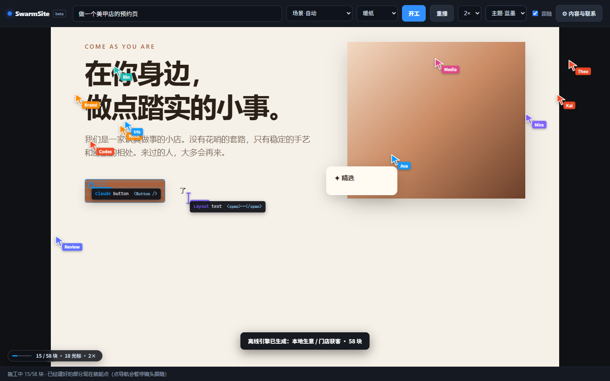
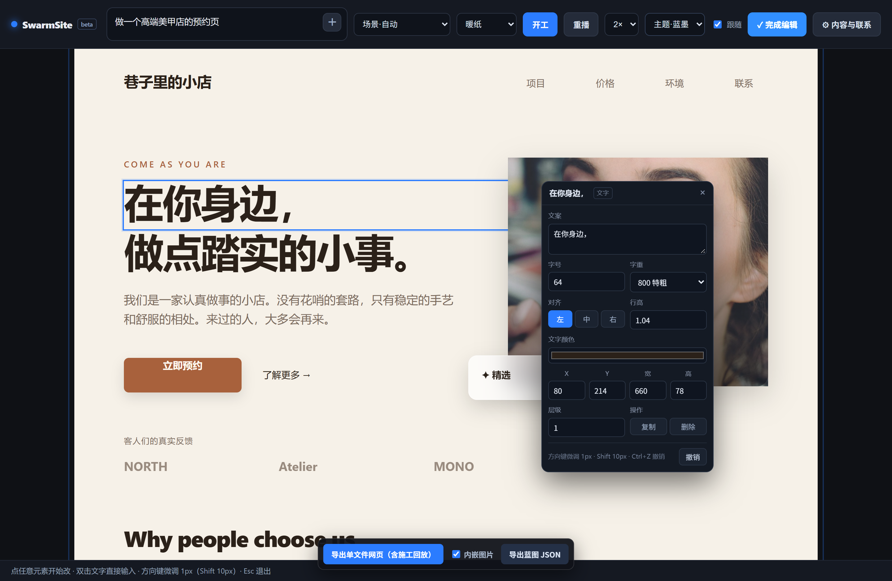
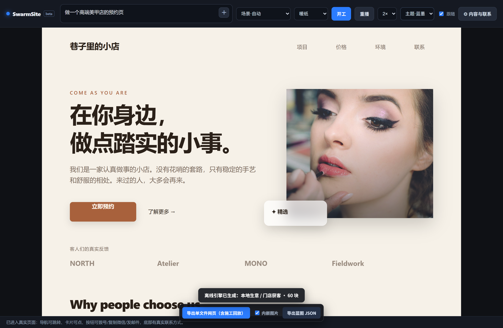

# SwarmSite — 一句话，让一群光标把网站"施工"出来

> 把「AI 生成网页」的等待过程，做成一场可以观看、可以打断、可以导出的**多光标施工表演**；结束时交给你一个按钮可用、离线可打开的单文件网页。

**版本 2.3.0** · Node 18+ · 263 项回环测试 · 许可证未指定




## 目录

- [这是什么](#这是什么)
- [适合与不适合](#适合与不适合)
- [快速开始](#快速开始)
- [功能地图](#功能地图)
- [四种生成方式](#四种生成方式)
- [核心机制](#核心机制)
- [蓝图 schema](#蓝图-schema)
- [项目结构](#项目结构)
- [测试](#测试)
- [常见问题](#常见问题)
- [路线图与已知边界](#路线图与已知边界)
- [设计决策](#设计决策)
- [许可证与致谢](#许可证与致谢)

## 这是什么

SwarmSite 解决的不是「生成一个更好的网站」，而是**让生成过程本身可见、可看、可分发**。输入一句话，一群带名字的协作光标会像设计团队一样施工：拉参考线、拖选框、逐字打字、钢笔描边、⌥ 拖拽复制卡片，完工后聚拢到你的鼠标周围。随后页面变成真网站——导航能跳转、按钮能拨号/复制微信/发邮件，最后导出成一个自带施工回放的 `.html`，双击就能看、发出去就能用。

和 Lovable / v0 / Kimi Build 这类工具不是同一件事：它们输出代码，强在编辑与迭代；SwarmSite 输出**一场表演 + 一个自包含网页**。要长期维护一个生产站点，请用前者；要给客户看「网页是怎么被做出来的」、做发布会/年会演示、做教学或短视频素材，用这个。它不假装自己是通用建站器。




## 适合与不适合

| 适合 | 不适合 |
| --- | --- |
| 提案现场：甲方说「标题小点、这块深点」，当场点一下，光标飞过去改完 | 需要长期迭代、多人协作、接后端数据库的生产网站 |
| 发布会 / 展会大屏：把网站「现场施工」出来当作揭幕动画 | 追求像素级还原设计稿、自定义任意 CSS 的场景 |
| 前端 / 产品教学：把抽象的盒模型、区块依赖变成看得见的过程 | 需要 SEO 站点地图、多语言路由、表单后端的完整站点 |
| 短视频 / 内容创作：录下施工过程作为「AI 在干活」的素材 | 移动端优先的页面（当前画布固定 1200 宽，手机上靠缩放，字偏小） |
| 快速做出一个能点、能联系你的单页并直接发给对方 | 需要精细字体排印、任意复杂交互的项目 |

## 快速开始

### 前置条件

- **零依赖路径**：一个现代浏览器（Chrome / Edge），双击 `index.html` 即可，不需要 Node。
- **推荐路径**：Node.js 18+，用于本机接口（在线 LLM、文档解析、图片缓存）。

### 方式 A：直接双击 `index.html`

能用离线引擎、剪贴板桥、本地模型（Ollama / LM Studio）。不能直连在线 API——`file://` 页面是「null 源」，浏览器会以跨域为由拦掉发往 `api.deepseek.com` 的请求，这不是 Key 的问题。

### 方式 B：启动本机接口（推荐）

双击 **`启动.bat`**（macOS / Linux 用 `./start.sh`），或执行 `npm start`。浏览器会打开 `http://127.0.0.1:5173`，端口被占用会自动 +1。`server.js` 把页面同源提供出来，并转发 `/api/llm/*`，浏览器只跟本机说话。

### 第一次使用

1. 写一句话（如 `做一个美甲店的预约页`），**或把文件拖进输入框**；选场景 / 配色，点「开工」。
2. 看光标群施工（默认 2×，约 10 秒；可切 1× / 3×，鼠标移动会被光标追随）。
3. 完工后点 **⚙ 内容与联系**：改文案、填微信/电话/邮箱、选按钮类型，再点「应用并重新施工」。
4. 点「✎ 点选编辑」可直接在页面上改任意元素（见[功能地图](#功能地图)）。
5. 点「进入网站」体验真实交互；底部导出：
   - **导出单文件网页** — 一个 `.html`，双击即自动重播施工，带重播按钮和真实可用的按钮；同时给出一段可复制的获客话术。
   - **导出蓝图 JSON** — 结构化数据，可再次导入编辑。

## 功能地图

### 施工表演

- **6 类施工动画**：矩形拖框带 W×H 徽章、文字打字机带光标、图片扫入、线条钢笔描边、参考线吸附、⌥ 拖拽复制带间距标注。
- **Boids 风格蜂群**：开场盘旋、施工中按页面块数动态派 9~20 个光标、完工后绕鼠标聚拢（轨道力 + 邻居对齐 + 鼠标避让）。
- **进度 HUD**：「已建 N/M 块 · X 光标 · 2×」，完成后显示总耗时。
- **边建边点**：每块完工即可交互，点导航/卡片时镜头暂停跟随 5 秒，不抢视线。
- **骨架态 + 降级**：施工中先出虚线框与灰条纹，落成时填充；系统开启「减少动态效果」时直接给成品页。

### 成品是一个能点的网站

导航平滑滚动并高亮、卡片引导到报名区并脉冲按钮、主按钮真的复制微信 / 拨号 / 发邮件 / 开链接；没填值时明确提示缺什么，不假装成功。可点元素支持键盘 Enter / Space，有焦点环。应用与导出页调用同一份 `SwarmRender.bind`，不会出现「应用里能点、发出去点不动」。

### 编辑

- **⚙ 内容与联系**：24 个可编辑字段，同一 `bind` 字段（如品牌名）在导航和页脚同步。
- **一句话改页面**：把当前蓝图和要求一起发给模型，只改点名的地方，给出差异摘要，可撤销 5 步。
- **✎ 点选编辑**：点任意块选中，检查器里改文案 / 字号 / 字重 / 对齐 / 行高 / 颜色 / 背景 / 圆角 / 透明度 / 坐标 / 层级；双击文字就地输入；换照片或上传自己的图；复制 / 删除；方向键微调 1px、Shift 10px、Ctrl+Z 撤销 40 步。
- 点选编辑**改的是蓝图不是 DOM**，所以重播、导出、再次施工都带着改动。

### 12 个场景与配色

从描述里自动识别，也可在「场景」下拉里手动指定；没命中时落到「通用」，把你话里的业务词写进文案，所以任何行业都不会出戏。

| 场景 | 面向的需求 | 默认 CTA |
| --- | --- | --- |
| 个人名片 / 个人品牌 | 一个人就是一家公司，需要能发出去的数字名片 | 加我聊聊 |
| 求职作品集 | 用作品证明自己 | 查看完整作品集 |
| 本地生意 / 门店获客 | 美甲、健身、家政等小店要预约和电话 | 立即预约 |
| 课程 / 社群招募 | 知识付费要报名转化 | 报名登记 |
| 自媒体 / 链接主页 | 博主聚合内容与联系方式 | 关注我 |
| 咖啡餐饮 / 科技 AI / 工作室 / 自然环保 / 活动峰会 | 通用行业 | 各自对应 |
| 通用（按你的话生成） | 兜底：直接用你的词写文案 | 现在联系 |

配色 8 套（暖纸 / 夜航 / 编辑 / 苔原 / 星云 / 工程 / 胭脂 / 薄荷）可随时切换并重新施工；施工主题 4 套（蓝墨 / 蓝图 / 霓虹 / 纸白）只改光标配色与舞台底色，不动动作编排。

### 文件输入

输入框和 WorkBuddy 一样可多行、可带文件：点 **＋**、拖到窗口任意位置、或截图后 Ctrl+V。

| 类型 | 格式 | 怎么读 |
| --- | --- | --- |
| 图片 | png / jpg / webp / gif / bmp / svg | 浏览器内压缩（最长边 1400px、JPEG 0.82），自动放到最大的图位 |
| 文本 / 代码 | txt / md / csv / json / html / css / js / ts / yml / py / sql … | 浏览器直接读，24000 字上限，拼进提示词 |
| 文档 | docx / xlsx / pptx / pdf | 本机接口 `POST /api/llm/extract`；Word 保留段落、Excel 保留列、PPT 分页 |
| 旧版 Office | doc / xls / ppt | 不支持，会提示另存为新格式 |

上限：单文件 18MB、文本 24000 字、同时 6 个文件。文档解析零依赖（OOXML 是 zip + XML，用 Node 内置 `zlib` 解）；PDF 走可选依赖 `pdf-parse`。附件文字只发给大模型，离线引擎按场景模板出文案。

### 导出

导出时只内联 `page-css` + `render-src` + `engine-src` + 蓝图，无外链。`#page` 里是**已经渲染好的静态 DOM**，脚本只负责「擦掉再画一遍」——所以脚本挂了、CSP 拦了、用户禁用了 JS，页面依然完整可读可滚，对搜索引擎也友好。

「内嵌图片」开关默认开：照片转 base64 打进 HTML，离线 / 微信里也能看图，代价是文件大 1~2MB；关掉则还原公开 CDN 地址。

## 四种生成方式

在 ⚙ → 「LLM / 蓝图」里切换：

| 模式 | 需要什么 | 适合谁 |
| --- | --- | --- |
| ① 离线引擎 | 无，不联网不填 Key | 默认。马上出活、演示、断网环境 |
| ② 剪贴板桥 | 任意 AI 对话框 | 不配接口：复制提示词 → 粘给 AI → 把回答复制回来 → 从剪贴板导入 |
| ③ 本地模型 | Ollama / LM Studio | 有显卡想本地跑，直连 127.0.0.1 不会被跨域拦 |
| ④ 在线 API + 本机接口 | 一个 Key | **推荐**：选服务商 → 填 Key → 保存到本机接口，之后「开工」直接流式生成 |

**④ 首次配置（约 30 秒）**

1. 启动本机接口，页面顶部显示绿色「本机接口已连通」。
2. ⚙ → LLM / 蓝图 → 生成方式选「④ 在线 API」。
3. 点服务商胶囊：DeepSeek / 通义千问 / Kimi / 智谱 GLM / OpenAI / 硅基流动（地址与模型名自动填好，填到 `/v1` 也会自动补 `/chat/completions`）。
4. 粘 Key → 「保存到本机接口」→「测试连接」。Key 写进项目目录 `.llm.json`（已进 `.gitignore`），页面不回显、只显示尾号，浏览器 `localStorage` 不再保存。
5. 直接「开工」，状态栏实时显示流式返回的字符数。

接口只监听 `127.0.0.1` 且校验 `Origin`，外部网站调 `/api/llm/*` 一律 403，防止别的页面蹭 Key。

**容错修复**：不管走哪条路，输出都过 `BlueprintGen.repair`——自动剥掉解释文字与 ` ```json ` 围栏、修尾逗号与中文引号、补 `meta`/宽高、处理重复 id 与失效依赖、把 `heading`/`button`/`img` 等别名映射到合法类型、统一 style 驼峰、把全堆在 `y=0` 的块纵向排开、夹紧越界坐标。还会把最大字号认成主标题、带 `action` 的认成按钮并补 `bind`，所以 LLM 生成的页面也能在编辑面板里改。

## 核心机制

### HTML → 蓝图 编译（`compiler.js`）

原来的契约是让模型直接吐绝对坐标，9 条提示词规则里 4 条讲坐标、0 条讲审美，结果所有行业排出来都是同一套骨架。2.2 版换成：

```
模型写语义 HTML（只写结构和 class，不写 CSS）
  → 隐藏 iframe 里用预置 CSS 排版
  → getBoundingClientRect 量出真实位置尺寸
  → 编译回蓝图格式
  → 施工动画照演
```

排版质量由 CSS 保证，结构与文案由模型决定；模型只从约 20 个 class 里挑（`hero` / `hero-center` / `hero-full` / `grid-3` / `card` / `media` …）。首屏形态**由本地按行业 + seed 决定**，不交给模型「三选一」——实测让 DeepSeek 选，8 次全选左文右图。安全上：HTML 先过白名单（危险标签删除、未知标签展开保留子节点、只留 `class`/`data-action`/`data-value`/`href`、`javascript:` 剥掉），再进 `sandbox="allow-same-origin"`（刻意不给 `allow-scripts`）的 iframe。编译产物仍是原来的蓝图，施工、交互、导出全部复用。

### 施工引擎（`index.html` 内联 `engine-src`）

按依赖分段调度（子等父、副本等母版、参考线先于文字吸附）；`engine.advance(ms)` 支持同步快进，不依赖动画帧，方便截图、录制和自动化测试。

### 图片代理（`server.js`）

页面 → `/img/<id>?w=` → 命中磁盘缓存直接回，未命中才回源一次并落盘。同一 id + 宽度并发只回源一次，失败重试 3 次；宽度夹到 200~2000 并对齐 50，避免同一张图存多份。上游宕机时已缓存的照常 200，未缓存的明确 502（前端露出渐变兜底）。缓存在 `.imgcache/`，可随时删。`file://` 下自动回落直连 CDN。

### 点选编辑（`app.js` + `SwarmRender.paintBlock`）

编辑态在捕获阶段拦点击，按钮不会真的跳转；改动写回 `blueprint.blocks`，只重刷那一个块。输入时不回填面板，避免打断中文输入法；切换选中或撤销时才刷新。退出编辑立刻恢复原有交互。

## 蓝图 schema

当前为 v2。示例：

```js
{
  meta: { title, industry, sceneKey, palette, paletteKey, width:1200, height:1810, bg, contact, ctaAction, ctaValue },
  blocks: [{
    id, type: 'rect|text|line|image|guide|duplicate',
    x, y, w, h, z, style: { fontSize:'18px', color:'#...', ... },
    text, role, label, code, orient,
    image, imageFallback,        // image: url(https://…) / url(data:…) / "asset:u1" / 渐变
    deps: [id], master: id,
    bind: 'brand|title1|title2|subtitle|cta|feature1t|...',  // 可编辑字段
    action: 'tel|wechat|mailto|link|none', actionValue: '...' // 按钮行为
  }]
}
```

蓝图描述的是**计算后的视觉结果**（位置 / 样式 / 文案），不是 DOM 结构，所以施工引擎能把它「演」出来。`bind` 让同一字段在导航和页脚同步；`action` 让 CTA 成为真实按钮。图片可直接给 CSS `url(...)`/渐变，或用 `"asset:u1"` 引用 `bp.assets`（`{u1: dataURL}`）中的上传图，导出时一并内联。`imageFallback` 是同色系渐变兜底。

## 项目结构

| 文件 | 作用 |
| --- | --- |
| `index.html` | 应用壳 + 页面样式 + 可导出的 `render-src` / `engine-src` 内联脚本 |
| `generator.js` | 场景系统、蓝图 schema、离线生成器、LLM 提示词与容错修复、字段提取/编辑/换色/校验 |
| `compiler.js` | HTML → 蓝图 编译器：预置 CSS 设计系统、白名单清洗、iframe 量尺寸、施工依赖生成 |
| `app.js` | 编辑面板、CTA 行为、四种 LLM 接入、一句话改页面、附件输入、导出与获客话术 |
| `server.js` | 本机接口（零依赖）：静态托管、LLM 流式转发与 Origin 守卫、文档解析、图片代理与内嵌 |
| `启动.bat` / `start.sh` | 一键启动本机接口并打开浏览器 |
| `styles.css` | 应用外壳样式（不进导出文件） |
| `.llm.json` / `.imgcache/` | 运行时生成：接口配置与 Key / 图片缓存，均已进 `.gitignore` |
| `tests/` | 七套回环测试，263 项断言，详见 [`tests/README.md`](tests/README.md) |
| `inbox/` | 并行任务收件箱：外部 AI 产出的 HTML / 素材，用于批量编译比对 |

## 测试

```bash
npm install && npm test
```

七套共 **263 项**，用本机已装的 Edge / Chrome 跑（不下载浏览器），约 7 分钟。覆盖主流程、LLM 接入、本机接口、文件输入、HTML 编译、图片代理、点选编辑；包含禁用 JS 打开导出页、`?nointro` 直出、脏 JSON 修复、5 并发回源去重等边界。单独跑某套用 `npm run test:main` / `test:llm` / `test:gateway` / `test:files` / `test:compiler` / `test:images` / `test:editor`。详见 [`tests/README.md`](tests/README.md)。

## 常见问题

**填了 Key 没反应？** 确认是用 `启动.bat` 打开的 `http://127.0.0.1:5173`，不是双击 `index.html`；`file://` 会被浏览器跨域拦截。再点「测试连接」看状态码。

**生成的版式每次都一样？** 2.2 起首屏形态由本地按行业 + seed 选，同一句话多次生成会换版式；若仍相同，检查是否走的是离线引擎（模板固定）。

**图片裂了 / 只剩渐变？** 本机接口模式下走同源代理，上游宕机且未缓存时会返回 502，前端自动露渐变，不会白块；可稍后重开。已缓存的图在断网时仍显示。

**导出文件太大？** 关掉导出栏的「内嵌图片」，文件会从 1~2MB 降到很小，但别人打开时需要联网。

**改完点选编辑，导出没带改动？** 改动写在蓝图里，点「导出蓝图 JSON」看 `blocks` 是否更新；重播施工和导出单文件都会带着它。若只改了页面上的文字，检查是否退出了编辑态（未提交就按 Esc 会取消）。

**施工太慢 / 太快？** HUD 旁有 1× / 2× / 3× 调速；系统开启「减少动态效果」时会跳过施工直接给成品。

**手机上字很小？** 当前画布固定 1200 宽，移动端靠缩放适配。这是已知边界，见[路线图](#路线图与已知边界)。

**Key 存在哪里、怎么清掉？** 存在项目根目录 `.llm.json`，⚙ 面板里点「清除」或删文件即可；浏览器不留 Key。图片缓存删 `.imgcache/`。

**控制台有报错？** 外链图片加载失败（`net::ERR_*`）属网络环境问题，不计入「零运行时错误」；应用本身有渐变兜底。

## 路线图与已知边界

按优先级：

1. **移动端**：按断点编译一份 750 宽蓝图，而不是等比缩 1200 画布。
2. **多页站**：导航真的换页，每页一份蓝图，施工时切页重建。
3. **上线分享**：云托管 + 免密钥调模型 + 云端文件与可分享链接。
4. 次要：施工音效（Web Audio 现场合成）、更多动画主题、施工过程录成视频、把点选编辑存成可复用样式预设。

已完成：~~图片稳定性~~（2.2：同源代理 + 磁盘缓存 + 导出内嵌）、~~点选编辑~~（2.3：点任意元素改文案 / 颜色 / 字号 / 位置，可撤销）。

## 设计决策

几处「为什么这么写」，都对应踩过的坑：

- **为什么是蓝图而不是 DOM 快照**：施工引擎需要按依赖逐块「演」出来，静态 DOM 无法分块调度；蓝图同时是编辑、导出、LLM 输出格式的唯一契约。
- **为什么让浏览器排版**：让模型吐坐标，注意力全耗在算像素和防重叠上，审美反而没位置；让模型写语义 HTML，排版交给预置 CSS，结构签名从 1 种变成 5 种、首屏形态从 1 种变成 3 种。
- **为什么图片走本机代理**：直连 CDN 在批量生成时会被 DNS 抖动 / 限流打断，整屏首屏变纯色；同源代理 + 磁盘缓存把「首次下载」变成「本地命中」。
- **为什么 Key 存服务端**：既避开 `file://` 的跨域限制，又不让 Key 进浏览器存储和页面 DOM；Origin 守卫防止被别的站点滥用。
- **为什么导出页先渲染静态 DOM**：施工回放是「擦掉再画一遍」，脚本失败、CSP 拦截、禁用 JS 时页面仍完整可读，也利于搜索引擎抓取。
- **为什么三层编辑共存**：内容与联系面板负责批量字段，一句话改页面负责整体语气，点选编辑负责局部微调；三者都写回同一份蓝图，互不覆盖。

## 许可证与致谢

本项目**尚未指定开源许可证**，代码默认保留所有权利；若要允许他人使用、修改或再发布，请由作者添加 `LICENSE`（如 MIT / Apache-2.0）后再对外声明。

内置照片来自 [Unsplash](https://unsplash.com) 公开 CDN。施工编排的灵感来自 swarm-cursors 类浏览器扩展（快照倒放）、Gesso（逐图层构建）以及各类 AI 建站工具的分块交互；本项目实现的是从自然语言直接驱动一场施工，并产出可分发的自包含网页。
