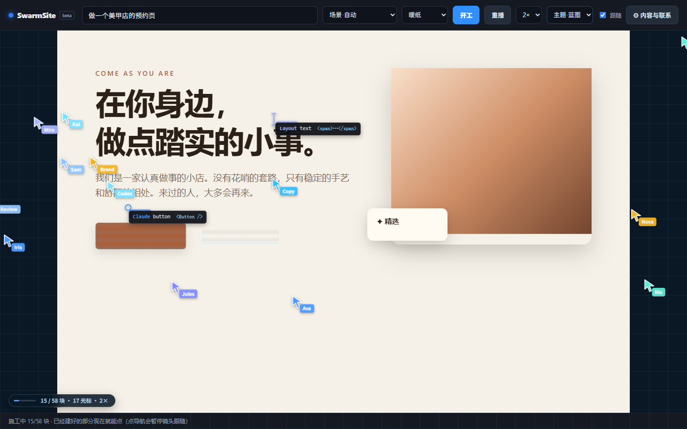

# SwarmSite — 一句话，让一群光标把网站建出来

一个能拿去做真实需求的 MVP：**输入一句自然语言，一群带名字的多人协作光标会像设计团队一样，把网页"施工"出来**——拉参考线、拖出选框、逐字打字、钢笔描边、⌥ 拖拽复制卡片，完工后聚拢到你鼠标周围。然后可以改内容、填真实联系方式、让按钮真能用，最后导出成一个自带施工回放的单文件网页发给潜在客户。

这是目前 GitHub / 市场上没有的组合：已有的项目要么"快照已有页面再倒放施工"（swarm-cursors 浏览器扩展），要么"AI 生成网站但只给你代码/日志"（v0、Lovable、Kimi Build），要么"AI 在画布上逐个图层构建"（Gesso）。**从自然语言直接驱动一场多光标施工表演，并产出一个按钮可用、可分发的自包含网页**，是这个项目要做的事。





## 怎么运行

有两种开法，区别只有一个：**要不要用大模型**。

| 开法 | 命令 | 能用的生成方式 |
| --- | --- | --- |
| 纯本地（最省事） | 双击 `index.html` | ① 离线引擎、② 剪贴板桥、③ 本地模型 |
| **带接口（推荐）** | 双击 **`启动.bat`**（或 `npm start` / `node server.js`） | 以上三种 + **④ 在线 API：填一次 Key 就一直能用** |

为什么要有第二种：`file://` 页面是「null 源」，浏览器会以跨域为由拦掉一切发往 `api.deepseek.com` 的请求——这也是"填了 Key 也没反应"的真正原因。`server.js` 把页面用 `http://127.0.0.1:5173` 提供出来，并开一个同源的 `/api/llm/chat` 帮你转发，浏览器只跟本机说话，Key 由服务端注入，任何 OpenAI 兼容服务商都能直连。启动脚本只是 `node server.js` 的壳子，会自动开浏览器、端口被占用自动 +1。

然后：

1. 写一句话（如 `做一个美甲店的预约页`），**或者把文件拖进输入框**，选场景/配色，点「开工」
2. 看光标群施工（15~40 秒，可 1×/2×/3× 调速，鼠标移动会被光标群追随）
3. 完工后点右上角 **⚙ 内容与联系**：所有文案都能改，填入微信号/电话/邮箱，选按钮类型
4. 点「应用并重新施工」，换上你的内容再演一遍；也可以去 **⚙ → 一句话改页面** 用一句话让模型改（见下）
5. 点「进入网站」体验真实页面（导航可跳转、卡片可点、按钮可拨号/复制微信/发邮件/开链接），底部导出：
   - **导出单文件网页** — 得到一个 `.html`，双击即自动重播整场施工，带重播按钮和真实可用的按钮，直接发给别人；导出后还会给出一段**可复制的获客话术**
   - **导出蓝图 JSON** — 结构化数据，可再次导入编辑

## 输入框：一句话，加上你电脑里的文件

顶部输入框和 WorkBuddy 一样是多行的，能带文件。三种给文件的方式：点 **＋**、把文件**拖**到窗口任意位置、截图后直接 **Ctrl+V**。

| 类型 | 格式 | 怎么读 | 读来干什么 |
| --- | --- | --- | --- |
| 图片 | png / jpg / webp / gif / bmp / svg | 浏览器内压缩（最长边 1400px、JPEG 0.82） | 进素材库，自动放到页面上最大的图位 |
| 文本 / 代码 | txt / md / csv / json / html / css / js / ts / yml / py / sql … | 浏览器直接读，24000 字上限 | 拼进提示词，让模型照你的资料写 |
| 文档 | **docx / xlsx / pptx / pdf** | 本机接口 `POST /api/llm/extract` | 同上；Word 保留段落、Excel 保留列、PPT 分页 |
| 旧版 Office | doc / xls / ppt | 不支持 | 会提示另存为 `.docx/.xlsx/.pptx` |

几个刻意的取舍：

- **Word / Excel / PPT 零依赖**：OOXML 本质是 zip + XML，用 Node 内置 `zlib` 解，不需要装任何包。PDF 编码（对象流、CID 字体）自己写不可靠，走可选依赖 `pdf-parse` —— 已写进 `dependencies`，`npm install` 就有了；万一没装，会明确告诉你 `npm i pdf-parse`，而不是静默失败
- **图片先压缩再进蓝图**：一张 3MB 手机照片会变成 200KB 左右，导出的单文件不会失控
- **上限**：单文件 18MB、文本 24000 字、同时 6 个文件
- **附件文字只发给大模型**：离线引擎是按场景模板出文案的，不读你的资料（它会照旧按那句话识别场景）

## 图片：现在是真的照片

以前主图是一块渐变色块，三处同时卡着：生成器只给 `linear-gradient`、提示词第 6 条明确写着「用 background 渐变当图」、schema 里 `image` 只是一个 CSS 字符串。现在：

- **内置照片库**：8 组场景 × 4–5 张无版权摄影作品（Unsplash CDN 直链），零 Key、零配置、不调任何接口。同一个标题稳定出同一张，不会刷新就换脸
- **三处用图**：首屏主图、三张卡片的小图、CTA 深色条当底图（叠一层深色遮罩保证文字可读）
- **加载失败不裂图**：图片块渲染成「`url(照片)` + 渐变」两层背景，图挂了自动露出渐变
- **你自己的图优先**：传了图就替换到面积最大的图片块上，其余仍用内置照片
- **大模型不用懂图片**：提示词只说「要图的地方写 `"image":"photo"`」，本机负责配真图 —— 让模型编图片地址只会得到 404。任何 LLM 出的蓝图（哪怕是色块或占位词）都会被 `enrichImages` 换成真实照片并保留渐变兜底

### 图片不再间歇性加载失败（2.2 版）

一开始照片是页面直连 `images.unsplash.com`。单独看没问题，批量生成时就开始掉图——DNS 抖动、限流都会让某个整屏首屏变成一块纯渐变。**远程图片直连本身就不可靠**，所以改成同源代理：

```
页面 → /img/photo-xxx?w=1200 → 本地缓存命中就直接回
                              → 没命中才去上游取一次，落盘后再回
```

跑在 `启动.bat` 下（`http://127.0.0.1:5173`）时会自动启用，三个直接收益：

| | 之前 | 现在 |
|---|---|---|
| 同一张图第二次打开 | 再下载一次 | 磁盘命中，0 网络 |
| 上游抖动 / 断网 | 图挂了，只剩渐变 | 已缓存的照常显示 |
| 生成时多张图同时要 | 并发打上游，容易被打断 | 同 id+宽度只回源一次，失败自动重试 3 次 |

缓存在 `.imgcache/`（已进 `.gitignore`），删掉即重建。宽度会夹到 200~2000 并对齐 50，避免同一张图因为差几个像素被存成好几份。

**导出也能带图了**：导出栏新增「内嵌图片」开关（默认开）。勾上时，导出会把用到的照片转成 base64 塞进那个 `.html`，别人**离线打开、发到微信里**都能看到图，代价是文件大 1~2MB。不勾就还原成公开 CDN 地址，文件小但要联网。

> 双击 `index.html`（`file://`）时无法用代理，会自动回落直连 CDN，行为跟以前一致。

## 自由版式：让模型写结构，让浏览器排版

这是 2.2 版最大的改动。原来的契约是让模型直接吐绝对坐标（`x/y/w/h`），提示词 9 条规则里 4 条在讲坐标、1 条在讲图片、0 条在讲审美。模型把大半注意力花在算像素、防重叠上，结果是**不管什么行业，排出来都是同一套骨架**：导航 → 大标题 → 副标题 → 按钮 → 主图 → 三卡 → 三数字 → CTA 条 → 页脚。换更强的模型，只会得到更整齐的方块。

现在的链路换成了：

```
模型写语义 HTML（只写结构和 class，不写 CSS）
  → 隐藏 iframe 里用一套预置 CSS 排版
  → getBoundingClientRect 量出每块真实位置和尺寸
  → 编译回原来的蓝图格式
  → 施工动画照演
```

关键点：

- **排版质量由 CSS 保证，结构与文案由模型决定**。模型只从一份 20 来个 class 的清单里挑（`hero` / `hero-center` / `hero-full` / `grid-3` / `card` / `media`…），不需要懂 CSS，也不会写坏排版
- **首屏由本地决定，不由模型决定**。实测让 DeepSeek「三选一」，8 次全选了左文右图；改成按行业给候选、再用 seed 挑，同一句话多次生成就会换版式
- **编译产物就是原来的蓝图**，所以施工动画、边建边点、可交互层、导出单文件全部复用，没有重写
- **安全**：HTML 先进白名单（危险标签整段删、未知标签展开保留子节点、属性只留 `class`/`data-action`/`data-value`/`href`、`javascript:` 链接剥掉），再进 `sandbox="allow-same-origin"`（**刻意不给 `allow-scripts`**）的 iframe，脚本不会执行
- **自动分流**：模型返回 HTML 就编译，返回 JSON 就走原来的坐标解析，不用手动选模式；HTML 编译失败会明确报错，退回坐标模式仍可用

实测 8 个行业（美甲 ×2、AI 写作、瑜伽、摄影、咖啡、宠物殡葬、设备租赁）各生成一次：**8/8 编译成功，结构签名 5 种，首屏出现 3 种形态（整屏大图 2 / 左文右图 5 / 居中 1），块数 48–82**。旧模板是 58 块、1 种骨架。

内置图库也跟着变了：`image:"photo"` 由本机按场景配真图；整屏首屏会额外补一层深色遮罩块（CSS 里那层是 `::before` 伪元素，采不到块，但编译产物是独立块渲染的，没有它白字会压在浅色照片上看不清）。

## 生成出来的不是一张图，是一个能点的网站

施工用的每一块都是真 DOM（绝对定位的 div + 文本节点），所以页面本身可以像正常网站一样被操作：

| 元素 | 点下去的后果 |
| --- | --- |
| 顶部导航（4 项） | 平滑滚到「特色 / 数据 / 报名 / 联系」区块，滚动时对应导航项自动高亮 |
| 「了解更多 →」 | 滚到特色区块 |
| 三张卡片 | 滚到报名区，并把 CTA 按钮脉冲高亮一次（引导转化） |
| 主按钮 / 报名区按钮 | 按配置真的执行：复制微信号 / `tel:` 拨号 / `mailto:` 发邮件 / 打开链接 |
| 页脚链接 | Email 走邮件，其余跳到联系方式区 |
| 底部联系方式行 | 执行同一个 CTA 动作（复制微信 / 拨号） |

细节：

- **只有能点的块接管鼠标**，其余块 `pointer-events:none`，所以点在卡片标题、按钮文字上也照样生效（不会被上层文字挡住）
- hover 有反馈：导航变淡并出现下划线、卡片抬升加阴影、按钮提亮并按压缩放
- 键盘可达：可点元素都是 `tabindex=0`，Enter/Space 可触发，有焦点环
- 「进入网站」会把镜头拉回首屏（施工时镜头一直跟着往下走）
- 导出的单文件调用的是同一份 `SwarmRender.bind`，所以发给客户的页面行为和应用里一模一样

## 12 个当下刚需场景

自动从你的描述里识别，也可在「场景」下拉里手动指定。关键词都没命中时落到「通用」场景，把你那句话里的业务词（比如"宠物殡葬""手冲咖啡豆"）填进文案，所以任何行业都不会出戏：

| 场景 | 面向的真实需求 | 默认 CTA |
| --- | --- | --- |
| 个人名片 / 个人品牌 | 一个人就是一家公司，需要能发出去的数字名片 | 加我聊聊 |
| 求职作品集 | 就业压力下用作品证明自己 | 查看完整作品集 |
| 本地生意 / 门店获客 | 美甲、健身、家政等小店要的是预约和电话 | 立即预约 |
| 课程 / 社群招募 | 知识付费要报名转化 | 报名登记 |
| 自媒体 / 链接主页 | 博主聚合内容与联系方式 | 关注我 |
| 咖啡/餐饮、科技/AI、工作室、自然/环保、活动/峰会 | 通用行业 | 各自对应 |
| 通用（按你的话生成） | 兜底：任何没命中的行业，直接用你的词写文案 | 现在联系 |

配色 8 套（暖纸/夜航/编辑/苔原/星云/工程/胭脂/薄荷），可随时切换并重新施工；施工主题 4 套（蓝墨/蓝图/霓虹/纸白），换的是光标配色与舞台底色，不动动作编排。

## 关键：按钮和联系方式是真的能用

这不是一个只能看的 demo。在「⚙ 内容与联系」里：

- 选按钮类型：**复制微信号** / **拨打电话** / **发邮件** / **打开链接**，并填对应的值
- 填页面底部展示的联系方式（微信、电话、地址等）
- 完工进入网站或导出后，点按钮会真的：复制微信号并提示去微信添加 / 手机直接拨号 / 打开邮件客户端 / 打开网址
- 没填值的时候不会假装成功，页面里会弹一条提示告诉你还缺什么
- 导出文件里这套行为完整保留，别人拿到手就能用

## 可交互层是怎么实现的

`index.html` 的 `render-src`（会被原样内联进导出文件）里有两个东西：

- `roleOf(block)` — 用蓝图里已有的 `label` 认角色：`nav link` → 导航、`card master/copy` → 卡片、`text link`/`footer link` → 文字链接、`contact line` → 联系方式、带 `action` 的块 → 按钮。LLM 产出的蓝图只要有 `action` 也能点，不需要 label。
- `SwarmRender.bind(root, meta, opts)` — 给这些块挂行为：导航用 `getBoundingClientRect` 算相对滚动容器的偏移做平滑滚动（在 `zoom` 缩放下也准），滚动时用 rAF 节流做 scrollspy 高亮；卡片点完滚动到报名区并给按钮加一次 `pulse` 动画。

应用（`app.js` 的 `bindActions`）和导出的单文件（`boot()` / `go.onclick`）调用的是同一个 `SwarmRender.bind`，所以不存在"应用里能点、发出去就点不动"的分叉。样式在同一份 `page-css` 里，导出时一起打包。

## 施工中的六个细节（从同类项目里学来的）

| 行为 | 说明 |
| --- | --- |
| **边建边点** | 每块施工完成就立刻可以点，不用等整页建完。点导航/卡片时镜头自动暂停跟随 5 秒，不跟你抢 |
| **骨架态** | 光标正在画的块先出蓝色虚线框 + 灰条纹，落成内容时"啪"一下填充，不是凭空出现 |
| **进度 HUD** | 左下角常驻"已建 N/M 块 · X 光标 · 2×"，完成后变成"完成 58 块 · 20 光标 · 10.9s" |
| **按页量派工** | 光标数量跟块数走（9~20 个），块多的页面自动多派人；滚动越快人越多 |
| **尊重减少动态** | 系统开了"减少动态效果"就完全不播，直接给成品页 |
| **失败即降级** | 导出页在 `?nointro`、带 `#锚点`、被 iframe 嵌入、被 CSP 拦脚本、用户禁 JS 时，都直接显示完整静态页面，不会白屏 |

## 施工引擎

- **58 个施工块**，完整依赖调度（子等父、副本等母版、参考线先于文字吸附）
- **6 类施工动画**：rect 拖框带 W×H 徽章、text 打字机带光标、image 扫入、line 钢笔描边、guide 参考线吸附、duplicate ⌥ 拖拽复制带间距标注
- **Boids 风格蜂群**：开场绕中心盘旋、施工中按滚动速度与页面上限动态增减光标、完工后绕鼠标聚拢（轨道力 + 邻居对齐 + 鼠标避让）
- **`engine.advance(ms)` 同步快进**：不依赖动画帧，方便截图、录制和自动化测试

## 把大模型接进来：填一次 Key，之后一直能用

点 ⚙ → 「LLM / 蓝图」。四种接法，从"零配置"到"真接口"：

| 模式 | 需要什么 | 适合谁 |
| --- | --- | --- |
| ① 离线引擎 | 无。不联网、不填 Key | 默认。想马上出活、演示、断网环境 |
| ② **剪贴板桥** | 任意一个能用的 AI 对话框 | 不想花钱/不想配接口：点「复制提示词」→ 粘给 AI → 把它回答复制回来 → 点「从剪贴板导入」 |
| ③ 本地模型 | Ollama / LM Studio（一键填预设） | 有显卡想本地跑，浏览器直连 127.0.0.1 不会被跨域拦 |
| ④ **在线 API + 本机接口** | 一个 Key | **推荐**：选服务商 → 填 Key → 保存到本机接口，之后点「开工」就直接让模型生成 |

④ 具体怎么用（一次性配置，约 30 秒）：

1. 双击 **`启动.bat`**（macOS/Linux 用 `./start.sh`），浏览器会打开 `http://127.0.0.1:5173`
2. ⚙ → LLM / 蓝图 → 生成方式选「④ 在线 API」
   - 面板顶部会显示**本机接口已连通**（绿条）。如果你又双击了 `index.html`，这里会变成黄色提示"本机接口没启动"，并给你复制启动命令的按钮
3. 点一个服务商胶囊：DeepSeek / 通义千问 / Kimi / 智谱 GLM / OpenAI / 硅基流动（地址和模型名自动填好，地址填到 `/v1` 也行，会自动补 `/chat/completions`）
4. 粘 Key → 点「保存到本机接口」
   - Key 写进项目目录的 `.llm.json`（已在 `.gitignore` 里），页面不会回显，只显示尾号
   - 同时浏览器 `localStorage` 里**不再保存 Key**，输入框也会被清空
5. 点「测试连接」验证，然后直接「开工」——生成过程是**流式**的，状态栏会实时显示"已返回多少字符"

> 接口里存的 Key 只给本机页面用：`server.js` 只监听 `127.0.0.1`，并且校验 `Origin`——外部网站对 `/api/llm/*` 的请求一律 403，防止别的页面蹭你的 Key。

不管走哪条路，输出都经过同一层**容错修复**（`BlueprintGen.repair`），所以"AI 乱来也能建"：

- 前后带解释文字、带 ```` ```json ```` 围栏、带尾逗号、带中文引号 → 自动剥掉/修掉
- 包了一层 `{site:{...}}` / 缺 `meta` / 缺 `width`、`height` → 补默认值
- `id` 重复、`deps` 指向不存在的块、`master` 指向不存在的母版 → 改名/丢弃/降级成普通矩形
- `type` 写成 `heading` / `button` / `img` / `hr` 这类别名 → 映射到 6 种合法块
- `style` 用 `font-size`、`font_size`、`background-color` 这类写法 → 统一成驼峰
- 所有块 `y` 都是 0（模型偷懒）→ 自动按顺序纵向排开，不会全叠在左上角
- 坐标超出画布、块数过多 → 夹紧、截断

修完还会把「字号最大的文字」认成主标题、「文本最长的」认成副标题、「带 action 的」认成按钮，自动补上 `bind`，所以 **LLM 生成的页面也能在编辑面板里改文案并生效**。

提示词由 `BlueprintGen.buildPrompt()` 统一生成（含 schema、8 条硬规则、一个两块的示例），离线/在线/剪贴板三条路径用的是同一份，不会出现"换条路效果就变差"。

## 一句话改这个页面

⚙ → **一句话改页面**（第三个页签）。它不重新生成整站，而是把**当前这版蓝图**和你的要求一起发给模型，拿回改过的完整蓝图，校验、修复、重新施工：

- 输入框写要求，或者点一个快捷胶囊：标题更有力 / 副标题缩短 / 加价格区 / 全文英文 / 换深色 / 首屏收紧 / 按钮改拨号
- 改完给出差异摘要：`新增 1 块 · 改了 3 块`
- 每次改动前自动留一份快照，点「撤销上一次修改」可以回退（最多 5 步）
- 右侧「改动记录」按时间列出你改过什么、改成了什么

这比"再重新生成一版"可控得多：布局是你已经满意的，模型只动你点名的地方。改坏了点撤销，原页面不会丢。

## 点选编辑：看哪儿不对就点哪儿

生成出来的页面总有一两处不顺眼——标题太大、按钮颜色不对、卡片位置偏高。以前只能回「⚙ 内容与联系」改文案，或者整页重来。现在点工具栏的 **✎ 点选编辑**，整页就变成可点的：

| 你做什么 | 发生什么 |
|---|---|
| 点任意元素 | 蓝框选中，旁边浮出检查器 |
| 改文案 / 字号 / 字重 / 对齐 / 行高 / 文字颜色 | 画面立刻变，蓝图同步 |
| 改背景色 / 圆角 / 不透明度 | 色块与图片块专用 |
| 改 X / Y / 宽 / 高，或按方向键 | 方向键 1px 一步，Shift 10px |
| **双击文字** | 就地输入，Esc 或回车提交 |
| 换一张照片 / 用自己的图 | 图片块专用；自己的图会一起打进导出文件 |
| 复制 / 删除 | 副本自动错开 20px 并接管选中 |
| Ctrl+Z | 撤销，最多 40 步（连续输入合成一步） |

三个实现上的关键点：

1. **改的是蓝图，不是 DOM**。每次改动都写回 `blueprint.blocks`，画面只是用 `SwarmRender.paintBlock` 重刷那一个块。所以**重播施工、导出单文件、再点「应用并重新施工」都带着改动**，不需要重新生成。
2. **编辑态在捕获阶段拦点击**。页面里的导航、按钮、卡片仍然是真实可用的，只是编辑态下点它们等于选中，不会跳走；退出编辑立刻恢复。带 `bind` 的块改完文案，内容面板里的同一字段也会同步，不会互相覆盖。
3. **输入时绝不回填面板**。早期版本每敲一个字就把面板值重设一遍，结果光标跳到末尾、中文输入法被打断。现在只有切换选中或结构变化才刷新面板，方向键也不会跟正在输入的输入框抢键。

> 编辑态下所有块都能点（平时只有可交互块能点），悬停有淡蓝描边，选中有实线框；按 Esc 先取消选中，再按一次退出编辑。

## 文件结构

| 文件 | 作用 |
| --- | --- |
| `index.html` | 应用壳 + 页面样式 + 可导出的 `render-src`/`engine-src` 内联脚本 |
| `generator.js` | 场景系统 + 蓝图 schema + 离线生成器 + LLM 提示词与容错修复 + 字段提取/编辑/换色/校验 |
| `index.html`（内联 engine） | 蜂群施工引擎：光标调度、任务 generator、动画、flocking、HUD、快进 |
| `compiler.js` | **HTML → 蓝图 编译器**：预置 CSS 设计系统 + 白名单清洗 + iframe 量尺寸 + 生成施工依赖 |
| `app.js` | 编辑面板、CTA 行为、施工交互、四种 LLM 接入、一句话改页面、**附件输入（读文件/压图/拖拽粘贴）**、导出单文件、获客话术 |
| `server.js` | **本机接口**（零依赖）：静态托管 + `/api/llm/health｜config｜chat` 转发、流式透传、Origin 守卫、`/api/llm/extract` 解析 docx/xlsx/pptx/pdf、`/img/<id>` 图片代理 + 磁盘缓存、`/api/img/embed` 导出内嵌 |
| `启动.bat` / `start.sh` | 一键启动本机接口并开浏览器 |
| `styles.css` | 应用外壳样式（不进导出文件） |
| `.llm.json` | 本机接口保存的地址 / 模型 / Key（自动生成，不入库） |
| `.imgcache/` | 图片代理的磁盘缓存（自动生成，不入库，可随时删） |
| `tests/` | 回环测试（七套，263 项断言），`npm i && npm test` |
| `inbox/` | 并行任务收件箱：外部 AI 产出的 HTML / 素材 / 设计参考，我批量编译比对 |

导出时打进单文件的只有 `page-css` + `render-src` + `engine-src` + 蓝图本体，没有任何外链，双击即开。
导出页的 `#page` 里是**已经渲染好的静态 DOM**，脚本只负责"擦掉再画一遍"——所以脚本挂了、被 CSP 拦了、用户关了 JS，页面依然完整可读可滚。同理它对搜索引擎也友好，不是一张图。

## 蓝图 schema（v2）

```js
{
  meta: { title, industry, sceneKey, palette, paletteKey, width:1200, height:1810, bg, contact, ctaAction, ctaValue },
  blocks: [{
    id, type: 'rect|text|line|image|guide|duplicate',
    x, y, w, h, z, style: { fontSize:'18px', color:'#...', ... },
    text, role, label, code, orient,
    image, imageFallback,        // image: url(https://…) / url(data:…) / "asset:u1" / 渐变
    deps: [id], master: id,
    bind: 'brand|title1|title2|subtitle|cta|feature1t|...',  // 可编辑字段
    action: 'tel|wechat|mailto|link|none', actionValue: '...' // 按钮行为
  }]
}
```

关键点：蓝图描述的是**计算后的视觉结果**（位置/样式/文案），不是 DOM 结构，所以施工引擎能把它"演"出来。`bind` 让同一字段（如品牌名）在导航和页脚同步更新；`action` 让 CTA 变成真实可用按钮。

图片有两种写法：`image` 直接给 CSS（`url(...)` 或渐变），或者 `image:"asset:u1"` 引用 `bp.assets` 里用户上传的图（`assets` 是 `{u1: dataURL}`，导出时一起内联）。`imageFallback` 是同色系渐变，照片加载不出来时兜底。

## 回环测试

```bash
cd tests && npm install && npm test
```

用本机已装的 Edge 跑（不下载浏览器），七套共 **263 项**断言，约 7 分钟。细节见 `tests/README.md`。

## 验证状态

用 Edge 无头浏览器（puppeteer-core）跑了七套回环测试，**263 项断言全部通过**：

**主流程 67 项**（`test.js`）
- 结构：三个模块挂载、4 套主题、12 个场景、24 个编辑字段
- 施工：58 块全部完成、无残留 pending/骨架、文字逐字打出、HUD 文案正确、可点块识别
- 边建边点：施工中途已完成块 `pointer-events:auto`、未完成块 `none`；点导航真的滚动且镜头暂停 6 秒
- 进入网站：回首屏、HUD 清理、导航滚动 + 高亮唯一、卡片引导 + 按钮脉冲、键盘 Enter 触发
- CTA：未填值给提示、填了微信号点击真复制
- 主题：属性/底色/光标配色三者同步，换主题后页面仍完整
- LLM：提示词骨架正确；7 类脏数据（围栏+废话、缺字段、id 冲突、y 重叠、尾逗号、外层包装、非 JSON）分别被正确修复；脏 JSON 走完整建站 + 改文案写回
- 导出：单文件无外链、内联静态内容、带 noscript、无 pending；**禁用 JS 仍能看到完整页面**；正常打开能自动施工、能进入网站、导航可滚动、可重播；`?nointro` 直出真页面并留播放入口
- 降级：`prefers-reduced-motion` 时不播动画直接给成品
- 零控制台错误

**接口 10 项**（`test-llm.js`，file:// 直连模式，用本地假 OpenAI 服务）
- 四种模式切换时显示对应的配置项；Ollama 预设一键填入
- 测试连接返回地址；接口返回"带前言 + 围栏"的内容也能建站成 8 块
- HTTP 500 时状态栏给出状态码和"改用剪贴板桥"的退路

**本机接口 28 项**（`test-gateway.js`，真起 `server.js` + 假上游）
- 健康检查、http 托管、无 Key 时本地上游也能转发
- 外部 Origin 调 `/api/llm/chat` 被 403 拦住
- 页面自动识别接口（绿条）、服务商预设一键填地址、保存后输入框与 localStorage 都不留 Key、`.llm.json` 里才有
- 刷新后仍是 API 模式、地址自动补回、Key 只显示尾号
- 流式返回的蓝图直接建站；一句话改页面生效、差异摘要正确、改动记录留痕、撤销能回退
- 清掉 Key 后提示"缺少 API Key"；上游 500 带状态码与原文；零运行时错误

**文件与输入框 29 项**（`test-files.js`，真起 `server.js` + 真上传文件）
- 解析：docx 出正文并保留段落、xlsx 出表格并保留列（制表符）、pptx 分页带页码、pdf 出文字
- 错误路径：旧版 `.doc` 提示另存为、未知格式有提示、空文件被拒、缺内容被拒
- 输入框：多行 textarea、附件按钮、文件列表默认隐藏
- 文本文件读出字数、图片生成 data: 缩略图并压缩到合理体积、移除按钮真的可见（这条抓出过 `.fx` 类名与引擎特效层撞车的 bug）
- 上传的图进蓝图后落在最大图片块上、其余图片块仍用内置照片
- 拖拽、粘贴、Enter 开工、Shift+Enter 换行、零运行时错误

**点选编辑 51 项**（`test-editor.js`，真起浏览器 + 真鼠标）
- 进入编辑态后所有块可点、按钮文案切换、导出行自动出现
- 点文字块 → 检查器只显示文案/字号/对齐/颜色，不显示背景色与换图
- 改字号 / 颜色 / 文案 → 画面、蓝图、内容面板字段、导出 JSON 四处同时变
- 对齐按钮、方向键 1px、Shift 10px、直接输坐标
- Ctrl+Z 撤销并把面板切回被撤销的那块
- 真实键入中文不会被"回填面板"打断（光标停在末尾）
- 双击文字就地输入，Esc 提交后写回蓝图
- 编辑态点按钮不会真的复制微信；改背景色同时落到画面和蓝图
- 换照片真的换另一张并刷到画面
- 复制块 id 不重复、删除块不留选中框、Ctrl+Z 能恢复
- 退出编辑后点导航能真的滚动；重播后改动仍在；导出的单文件里带着新文案/字号/颜色

**图片代理 33 项**（`test-images.js`，真起 `server.js` + 假图库上游 + 真浏览器）
- 首次回源并落盘、第二次 `X-Img-Cache: hit` 且上游计数不增加、长缓存头存在
- 宽度 `99999` 被夹到 2000、非法 id / 空 id 被拒、`HEAD` 可用
- 5 个并发请求同一张图只回源 1 次
- **上游宕机时已缓存的图照常 200**，没缓存的明确 502（前端露出渐变，不裂图）
- 内嵌接口返回 `data:image/jpeg;base64,…`，非法 id 单独报错不影响其他图
- 页面在 http 下自动启用代理（`__SWARM_IMG_PROXY`）、图片能解码出真实像素、每张图都带渐变兜底
- 导出：勾内嵌 → 文件里是 base64 且无代理路径；不勾 → 还原公开 CDN 且文件更小
- `file://` 双击打开时不开代理，回落直连 CDN

性能：58 块页面在 1× 下约 20s、2×（默认）约 10s、3× 约 7s；光标稳定在 9~20 个。

## 下一步

按优先级：

1. **移动端**：画布仍是固定 1200 宽，手机上靠 `zoom` 缩、字很小。编译器现在已经拿到真实 CSS 布局，可以按断点再编译一份 750 宽的蓝图，这是 P2 之后的自然延伸。
2. **多页站**：导航真的换页，不是锚点滚动。每页一份蓝图，施工时切页重建。
3. **上线分享**：接云托管，同时解决「免密钥调模型 + 文件云端存 + 可分享链接」。
4. 次要：施工音效（Web Audio 现场合成，不引音频文件）、更多施工动画主题、把施工过程录成视频、把点选编辑的改动存成"样式预设"复用。

已完成：~~图片稳定性~~（2.2：同源代理 + 磁盘缓存 + 导出内嵌）、~~点选编辑~~（2.3：点页面任意元素改文案/颜色/字号/位置，可撤销）。
